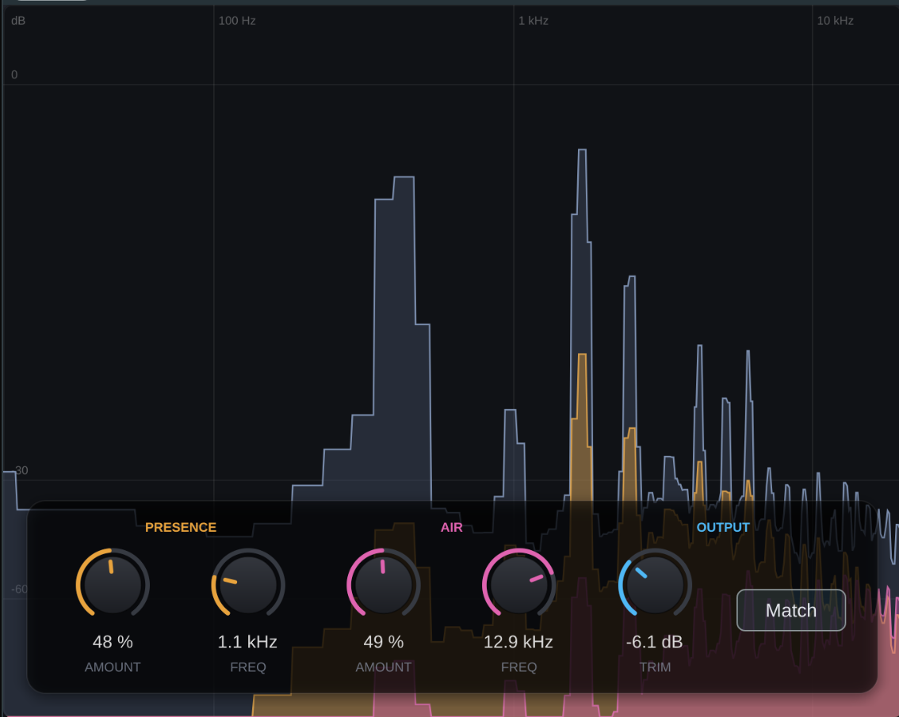

# ParametricAir

Langue : [Fr | [En](README.md)]



ParametricAir est un plugin qui permet de booster la "présence" et "l'air", inspiré de FreshAir.
C'est mon premier plugin audio, écrit en C++ avec JUCE. C'est davantage un projet d'apprentissage qu'un produit fini, mais il est tout à fait utilisable.

## Fonctionnement

Le signal d'entrée est divisé en deux bandes : **presence** (800 Hz à 6 kHz) et **air** (4 kHz à 18 kHz).
Chaque bande est compressée en parallèle avant d'être rajoutée au signal d'entrée.

Cela apporte l'ouverture d'un important boost dans les hautes fréquences sans l'agressivité qui accompagne un simple boost d'EQ.

L'affichage en haut du plugin montre le spectre d'entrée ainsi que la contribution des deux bandes en temps réel (entrée en gris, presence en jaune/orange, air en rose).

## Compilation

Requiert CMake 3.22 ou version ultérieure et un compilateur C++17. JUCE est inclus en tant que sous-module Git.

```sh
git clone --recurse-submodules https://github.com/gabinollier/ParametricAir.git
cd ParametricAir
cmake -B build/release -DCMAKE_BUILD_TYPE=Release
cmake --build build/release
```

Si vous avez cloné le dépôt sans le sous-module, lancez d'abord `git submodule update --init`.

Sous Linux, JUCE nécessite généralement aussi quelques paquets :

```sh
sudo apt install libasound2-dev libfreetype6-dev libgl1-mesa-dev libx11-dev \
    libxcomposite-dev libxcursor-dev libxext-dev libxinerama-dev libxrandr-dev libxrender-dev
```

La compilation produit un plugin VST3 et une application standalone.
